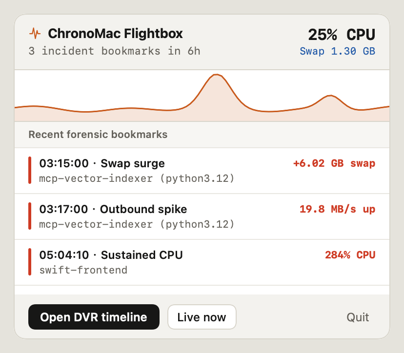

# ChronoMac

**English** | **[简体中文](README.zh-CN.md)**

**macOS User-Space System Flight Recorder (Records While Open), 5-Track DVR Timeline & External Socket Ledger**

`Activity Monitor` and `btop` only show *right now*—if your Mac thermal-throttles during a build, balloons into multi-gigabyte VM swap, or uploads hundreds of megabytes while ChronoMac is open and the culprit child process exits minutes later, live monitors have already forgotten what happened.

**ChronoMac** (`v0.2.0` latest release; M0 hardening below marked **Unreleased (after `v0.2.0`)**) records host telemetry, top process blame snapshots, external TCP/UDP/QUIC socket byte deltas, and local AI coding agent session spans (`Claude Code`, `Codex CLI`, `OpenCode`) every 2 seconds **while the ChronoMac app/menu bar is open**, storing history in a bounded SQLite WAL flightbox (`<= 250 MB` including `-wal`/`-shm`) in **100% non-root user space**—with zero kernel extensions (`KEXT`) or paid `NetworkExtension` entitlements, plus live in-app **`中文 / EN`** bilingual switching (`⇧⌘L`).


> **`[DEMO]` Synthetic Preview Data**: The screenshot above is rendered from deterministic synthetic data (`ChronoMac --demo` — *Unreleased (after `v0.2.0`)* / `ChronoMonitor.preview()`) illustrating a simulated swap & outbound network incident.

---

## Verified Capabilities (`v0.2.0` + Unreleased M0 Hardening)

- **Synchronized 5-Track DVR Oscilloscope (`TimelineScrubberCanvas`)** — Scrub across **1h / 6h / 24h / 7d** windows of recorded history to correlate SoC CPU & thermal state, host memory + VM swap, disk R/W throughput, external network throughput, and AI coding agent session windows.
- **Post-Mortem Process Blame with Delta & Liveness** *(Unreleased after `v0.2.0`)* — Time-travel to any recorded timestamp or anomaly bookmark. ChronoMac reports the exact time offset from your requested timestamp (`Snapshot at <ts> (<Y>s from requested time)`), whether each process is **`still running`** or **`exited after spike`**, and lets you rank explicitly **By CPU**, **By Memory**, or **By Network** (`--sort cpu|memory|network`).
- **Honest `Memory Footprint (phys_footprint)` & Permission Boundaries** *(Unreleased after `v0.2.0`)* — Reports Mach `ri_phys_footprint` (matching macOS Activity Monitor's *Memory* metric rather than BSD `RSS`). System/root processes enumerable via `sysctl(KERN_PROC_ALL)` whose `proc_pid_rusage` counters are restricted in non-root user space (e.g., `WindowServer`, `launchd`, `kernel_task`) remain visible and display **`No permission`** instead of fake `0.0%` readings.
- **External Socket Ledger with Loopback Isolation** *(Loopback isolation, empty-tick baseline guard & 60-tick socket retention window: Unreleased after `v0.2.0`)* — Computes per-process external socket deltas from non-root `/usr/bin/nettop -L 1 -n -J interface,state,bytes_in,bytes_out` per-socket snapshots with asynchronous local PTR reverse-DNS resolution. Loopback traffic (`127.0.0.0/8`, `::1`, `lo0`) is tracked in its own dedicated counter, excluded from external inbound/outbound totals, and never triggers outbound anomaly alerts. The global baseline is established on the first snapshot containing at least one parsed data row (empty or header-only snapshots never consume the baseline); on subsequent ticks, newly appearing sockets carry post-baseline bytes and are attributed on first sight rather than dropped to `0`, while `lastSeen` per-socket counters (`pid|socket`) are retained for up to `maxAbsentTicks = 60` polls (`current >= prev` -> `current - prev`; `current < prev` -> `current`; evicted after `> 60` absent polls so state stays bounded) so transiently absent sockets never replay cumulative historical totals. **OS limitation**: if macOS reuses the exact same PID and socket endpoint/4-tuple within the 60-tick retention window and the new connection already exceeds the previous cumulative byte count before the next poll, `nettop` exposes no socket creation birth-time to distinguish them (`current - prev` under-counts by `prev`). Unresolved executable paths remain blank rather than copying short `comm` names.
- **Peak-Preserving 3-Tier Compaction & Hard Storage Ceiling** *(Bucket alignment & WAL-inclusive cap: Unreleased after `v0.2.0`)* — Keeps raw `2s` ticks for 2 hours, compacts completed buckets into monotonic peak-preserving `15s` (2h–24h) and `60s` (24h–7d) rollups (`ON CONFLICT DO UPDATE SET ... MAX(...)`), checkpoints WAL (`PRAGMA wal_checkpoint(TRUNCATE)`), and enforces a strict on-disk cap (`sqlite + wal + shm <= maxDatabaseBytes`, default `250 MB`) with page reclamation.
- **Calibrated Human-Readable CLI (`--cli`) & Read-Only MCP Server (`--mcp`)** *(Calibrated `1.0s` `status`, human-readable tables, `--json`, `--db`, exit code `2`: Unreleased after `v0.2.0`)* — `ChronoMac --cli status` samples Mach CPU load ticks twice `1.0s` apart for calibrated CPU% readings; `status`, `blame`, `anomalies`, and `egress` emit clean human-readable output in English or Simplified Chinese (`--lang en|zh`) or structured JSON (`--json`), opening SQLite strictly read-only (`--db <path>` or `CHRONOMAC_DB_PATH`).
- **Live `中文 / EN` Bilingual UI** — Auto-detects Chinese macOS locale on first launch and switches instantaneously via the `中文 | EN` pill, `⇧⌘L`, or `--lang zh|en`.

<p align="center">
  
</p>
<p align="center"><em><code>[DEMO]</code> Menu bar popover rendered from synthetic preview telemetry (<code>ChronoMonitor.preview()</code>).</em></p>

---

## Recording Scope & Roadmap

- **Current (`v0.2.0` + Unreleased M0)**: Telemetry is sampled and persisted every 2 seconds **while the ChronoMac GUI / menu bar app is running**. `--cli` and `--mcp` are strictly read-only query interfaces and do not run a background collector.
- **Planned (M1)**: Headless background recording daemon (`chronomac record`) + optional `LaunchAgent` plist (`~/Library/LaunchAgents/io.github.zxu756.chronomac.plist`) for continuous 7-day unattended recording when the GUI window is quit, validated against `powermetrics` / `vm_stat` / `netstat -ib`.
- **Planned (M2)**: Richer attribution & correlation workflows on top of the verified background flightbox.

See [docs/SPEC.md](docs/SPEC.md) for architecture, schema, and measurement specifications.

---

## Install (`v0.2.0`)

### Homebrew Cask (macOS 14.0+, Apple Silicon)

```bash
brew tap zxu756/tap
brew install --cask chronomac
```

### Direct Release Archive

Download `ChronoMac-v0.2.0-macos-arm64.zip` from Releases, move `ChronoMac.app` to `/Applications`, and clear quarantine if needed:

```bash
xattr -cr /Applications/ChronoMac.app
```

### Build & Test from Source

> Note: `./Scripts/test.sh` is **Unreleased (after `v0.2.0`)** on source builds.

```bash
git clone https://github.com/zxu756/ChronoMac.git
cd ChronoMac
./Scripts/test.sh scope Store Sampler CLI
./Scripts/build-app.sh
```

---

## CLI & MCP Server Usage

### Headless CLI (`--cli`)

> **Release note (`v0.2.0` vs Unreleased)**: `v0.2.0` introduced `--cli` (`status`, `blame --at`, `anomalies`, `egress`), `--mcp`, and `--lang en|zh`. Read-only SQLite isolation (`--db <path>`, `CHRONOMAC_DB_PATH`), `1.0s` calibrated `status`, human-readable table formatting, `--json`, `--sort cpu|memory|network`, `--minutes <N>`, `--hours <N>`, `--help`, and exit code `2` on invalid flags/subcommands are **Unreleased (after `v0.2.0`)**.

All `--cli` commands open the SQLite database **read-only** (`--db <path>` or `CHRONOMAC_DB_PATH`, defaulting to `~/Library/Application Support/ChronoMac/flightbox.sqlite`). Unknown flags or subcommands print an error to `stderr` and exit with code `2`.

```bash
# Calibrated live host readout (two CPU ticks 1.0s apart) + flightbox status
ChronoMac --cli status --lang en

# Structured JSON host readout
ChronoMac --cli status --json

# Inspect historical process blame 10 minutes ago (ranked by CPU, memory, or network)
ChronoMac --cli blame --at 10m --sort cpu --lang en
ChronoMac --cli blame --at 10m --sort memory --json

# Summarize window peaks & recorded anomaly bookmarks over the last 6h (360m)
ChronoMac --cli anomalies --minutes 360 --lang en

# List top external socket endpoints over the last 24h (loopback excluded)
ChronoMac --cli egress --hours 24 --lang en
```

### Model Context Protocol (`--mcp`)

Add `ChronoMac` to Claude Code, Codex, or OpenCode so your agent can query recorded spikes read-only over stdio:

```json
{
  "mcpServers": {
    "chronomac": {
      "command": "/Applications/ChronoMac.app/Contents/MacOS/ChronoMac",
      "args": ["--mcp"]
    }
  }
}
```

Exposed read-only MCP tools:
- `chrono_summary_window` — Peak CPU, swap, external outbound egress, and anomaly bookmarks in the last `N` minutes.
- `chrono_inspect_timestamp` — Top process snapshot near `epoch_seconds` or `minutes_ago` (`sort_by`: `cpu`, `memory`, or `network`), reporting exact snapshot delta seconds, `Memory Footprint (phys_footprint)`, `No permission` for restricted system processes, and `still running` vs `exited after spike`.
- `chrono_top_egress_endpoints` — Highest-volume external remote endpoints (loopback excluded) over the last `N` hours.

---

## Storage & Privacy Architecture

- **Default database path**: `~/Library/Application Support/ChronoMac/flightbox.sqlite` (override via `--db <path>` or `CHRONOMAC_DB_PATH` for isolated testing).
- **100% local, zero network telemetry**: All Mach VM/CPU counters, `proc_pid_rusage` footprints, `nettop` deltas, and local `getnameinfo` PTR lookups remain strictly on local disk.
- **Exact AI coding agent metadata read (read-only)**:
  - **Claude Code (`~/.claude/projects/<slug>/*.jsonl`)**: Reads directory listing modification timestamps and parent folder slug only; `.jsonl` conversation files are never opened or parsed.
  - **OpenCode (`~/.local/share/opencode/opencode.db`)**: Opens SQLite with `SQLITE_OPEN_READONLY` and reads `session.title` (truncated to 22 characters) and `time_created` / `time_updated` timestamps as timeline labels.
  - **Codex CLI (`~/.codex/state_5.sqlite`)**: Opens SQLite with `SQLITE_OPEN_READONLY` and reads `threads.cwd` (last path component directory name) and `created_at` / `updated_at` timestamps as timeline labels.
  - Prompt bodies, model responses, API keys, and repository source files are **never** read.

## License

MIT License — see [LICENSE](LICENSE).
