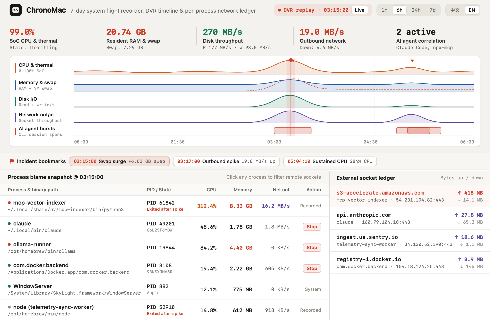

# ChronoMac

**English** | **[简体中文](README.zh-CN.md)**

**7-Day macOS System Flight Recorder, 5-Track DVR Oscilloscope & Per-Process Outbound Socket Ledger (`v0.2.0`)**

`Activity Monitor` and `btop` only show *right now*—if your MacBook thermal-throttled at 03:14 AM, ballooned to 6 GB of VM swap, or uploaded 400 MB while unattended and the culprit process exited five minutes later, the forensic trail is gone.

**ChronoMac `v0.2.0`** continuously records host telemetry, top-30 process blame snapshots, external TCP/UDP socket byte deltas, and local AI coding agent bursts (`Claude Code`, `Codex CLI`, `OpenCode`) into a bounded SQLite WAL time-series flightbox (`<= 250 MB`), running 100% in **non-root user space** with zero kernel extensions (`KEXT`) or paid `NetworkExtension` entitlements—now with live in-app **`中文 / EN`** bilingual switching (`⇧⌘L`) and automatic macOS Chinese locale detection.



---

## Key Capabilities

- **Synchronized 5-Track 60fps DVR Oscilloscope (`TimelineScrubberCanvas`)** — Scrub seamlessly across **1h / 6h / 24h / 7d** to correlate SoC CPU & thermal state, resident RAM + VM swap, disk R/W throughput, network egress/ingress, and active AI coding agent windows.
- **Post-Mortem Process Blame (Even After Exit)** — Time-travel to any anomaly bookmark and inspect exact PID, binary path, Apple/Developer Team ID signature, CPU %, RSS footprint, and outbound transfer rate—highlighting processes that have already terminated (`Exited after spike`).
- **Per-Process External Socket Ledger** — Parses non-root `nettop` byte deltas and asynchronous local PTR reverse-DNS lookups (loopback `127.0.0.1` automatically excluded) so you know *which binary* talked to *which remote host* and how many megabytes left your Mac.
- **Peak-Preserving 3-Tier SQLite WAL Compaction** — Keeps raw `2s` ticks for 2 hours, rolls 2h–24h into peak-preserving `15s` buckets, rolls 24h–7d into `60s` buckets, and enforces a hard `250 MB` database cap with `PRAGMA incremental_vacuum`.
- **Live `中文 / EN` Bilingual Instrument UI (`v0.2.0`)** — Auto-detects Chinese macOS system locale on first launch, remembers preference in `UserDefaults`, and switches every header, DVR track, table, and MenuBar popover instantaneously via the top-right `中文 | EN` pill, `⇧⌘L`, or `--lang zh|en`.
- **Menu Bar Flightbox + Headless CLI + Read-Only MCP Server** — Ships as both a warm-titanium macOS instrument app and an MCP server (`--mcp`) so Claude Code, Codex, or OpenCode can answer *"Why did my Mac lag 15 minutes ago?"* directly from telemetry.

<p align="center">
  
</p>

---

## Install (`v0.2.0`)

### Homebrew Cask (macOS 14.0+, Apple Silicon)

```bash
brew tap zxu756/tap
brew install --cask chronomac
```

### Direct Release Archive

Download `ChronoMac-v0.2.0-macos-arm64.zip` from Releases, extract `ChronoMac.app` to `/Applications`, and clear quarantine if needed:

```bash
xattr -cr /Applications/ChronoMac.app
```

### Build from Source

```bash
git clone https://github.com/zxu756/ChronoMac.git
cd ChronoMac
swift test --no-parallel
./Scripts/build-app.sh
open build/ChronoMac.app
```

---

## CLI & MCP Server Usage

### Headless CLI & Language Override

```bash
# Launch UI with explicit language override (zh or en)
/Applications/ChronoMac.app/Contents/MacOS/ChronoMac --lang zh

# Live Mach host readout + flightbox status
/Applications/ChronoMac.app/Contents/MacOS/ChronoMac --cli status

# Inspect historical process blame 10 minutes ago
/Applications/ChronoMac.app/Contents/MacOS/ChronoMac --cli blame --at 10m

# Summarize recorded swap/thermal/egress anomalies over last 6h
/Applications/ChronoMac.app/Contents/MacOS/ChronoMac --cli anomalies

# List top external endpoints by bytes transferred over last 24h
/Applications/ChronoMac.app/Contents/MacOS/ChronoMac --cli egress
```

### Model Context Protocol (`--mcp`)

Add `ChronoMac` to Claude Code, Codex, or OpenCode so your agent can inspect system bottlenecks during builds and benchmarks:

```json
{
  "mcpServers": {
    "chronomac": {
      "command": "/Applications/ChronoMac.app/Contents/MacOS/ChronoMac",
      "args": ["--mcp"]
    }
  }
}
```

Exposed read-only MCP tools:
- `chrono_summary_window` — Peak CPU, swap, outbound egress, and anomaly bookmarks in the last `N` minutes.
- `chrono_inspect_timestamp` — Exact top-process snapshot at a Unix epoch or `minutes_ago`.
- `chrono_top_egress_endpoints` — Highest-volume external socket destinations grouped by executable.

---

## Storage & Privacy Architecture

- **Database location**: `~/Library/Application Support/ChronoMac/flightbox.sqlite`
- **Zero telemetry**: All Mach VM/CPU counters, `proc_pid_rusage` footprints, `nettop` deltas, and `getnameinfo` PTR lookups stay strictly on your local disk. AI agent correlation reads only session modification timestamps—never prompt contents.

## License

MIT License — see [LICENSE](LICENSE).
