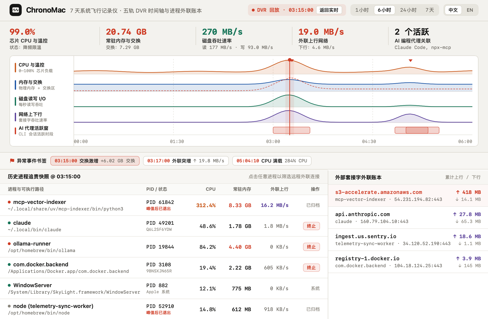

# ChronoMac

**[English](README.md)** | **简体中文**

**macOS 用户态系统飞行记录仪（应用开启期间录制）· 五轨 DVR 示波时间轴与外部外联账本**

系统自带的「活动监视器」与 `btop` 只能看到**此时此刻**——如果在运行 ChronoMac 期间，你的 Mac 突然热压降频、虚拟内存交换区暴涨数 GB，或子进程上传数百 MB 数据后在几分钟内自动退出，传统实时监视器将无法还原事发现场。

**ChronoMac**（最新已发版 `v0.2.0`；下方 M0 修正项均标注为 **未发布（`v0.2.0` 之后）**）在 **100% 普通用户态（免 Root、零内核扩展 `KEXT`、无需付费 `NetworkExtension` 权限）** 下，于 **ChronoMac 主窗口或菜单栏常驻开启期间** 每 2 秒采集一次主机遥测、历史进程追责快照、外部 TCP/UDP/QUIC 套接字增量与本地 AI 编程代理活跃时段（`Claude Code`、`Codex CLI`、`OpenCode`），写入严格受控的 SQLite WAL 时序飞行匣（含 `-wal`/`-shm` 默认总上限 `<= 250 MB`），并原生内置 **`中文 / EN` 双语实时切换**（`⇧⌘L`）。


> **`[DEMO / 演示数据]` 说明**：上方截图由确定性合成演示数据（`ChronoMac --demo` —— *未发布（`v0.2.0` 之后）* / `ChronoMonitor.preview()`）渲染生成，用于展示模拟的交换激增与外联流量异常回放效果。

---

## 已验证核心特性 (`v0.2.0` + 未发布 M0 修正)

- **五轨同步 DVR 示波时间轴 (`TimelineScrubberCanvas`)** — 在已录制的 **1小时 / 6小时 / 24小时 / 7天** 历史窗口内拖拽回放，同屏对照芯片 CPU 与温控状态、主机内存与虚拟交换区、磁盘读写吞吐、外部网络上下行速率与 AI 编程代理会话窗口。
- **诚实标注时间偏差与存活状态的历史进程追责** *（未发布，`v0.2.0` 之后）* — 回溯任意历史时刻或异常书签时，明确显示实际快照与所查时刻的秒级偏差（`取自 <时间> 的快照（距所查时刻差 <Y> 秒）`），逐行标注进程当前 **`仍在运行`** 还是 **`尖峰后已退出`**，并提供 **按 CPU / 按内存 / 按网络**（`--sort cpu|memory|network`）三种显式排序维度。
- **准确的 `物理内存占用 (phys_footprint)` 与权限边界标注** *（未发布，`v0.2.0` 之后）* — 报告 Mach `ri_phys_footprint`（与 macOS「活动监视器」的“内存”列一致，而非传统 `RSS`）。对于通过 `sysctl(KERN_PROC_ALL)` 枚举到但普通用户无权调用 `proc_pid_rusage` 读取 CPU 的系统/Root 进程（如 `WindowServer`、`launchd`、`kernel_task`），界面与 CLI 均保留显示并明确标注 **`无权限`**，绝不伪造 `0.0%` 空闲读数或静默丢弃。
- **隔离本机回环的外部套接字账本** *（回环隔离、空快照基线保护与 60 拍套接字保留窗口：未发布，`v0.2.0` 之后）* — 基于非特权 `/usr/bin/nettop -L 1 -n -J interface,state,bytes_in,bytes_out` 逐套接字快照计算外部流量增量并配合异步本地 PTR 反向 DNS 解析。本机回环流量（`127.0.0.0/8`、`::1`、`lo0`）单独计入专用回环计数器，绝不混入外部上下行总量，也绝不触发外联异常告警；全局基线仅在首个包含至少 1 条有效数据行的快照上建立（空输出或仅含表头的快照绝不消耗初始基线）；建基线之后首次出现的新套接字直接计入当拍增量而绝不静默丢弃为 `0`，同时按 `pid|socket` 将上次见到的累计字节保留最多 `maxAbsentTicks = 60` 拍（窗口内 `current >= prev` 计 `current - prev`、`current < prev` 按计数器重置计 `current`，缺席超过 `60` 拍自动淘汰以约束内存上界），避免短暂缺席后重现的连接把历史累计值重复算作单拍增量。**操作系统限制**：若 macOS 在 60 拍保留窗口内复用了完全相同的 PID 与套接字四元组标识，且新连接在下次轮询前累计字节已超过旧连接保留值 `prev`，因 `nettop` 不暴露套接字创建时间戳，无法区分新旧连接（`current - prev` 会少算 `prev` 字节）。无法解析完整可执行路径的进程将 `exec_path` 留空，绝不将短进程名伪装为路径。
- **峰值无损保留的三级压缩与硬性存储上限** *（整桶对齐与含 WAL 硬上限：未发布，`v0.2.0` 之后）* — 近 2 小时保留 `2s` 原始采样；仅在整个时间桶完全跨过阈值后才聚合为 `15s`（2–24 小时）与 `60s`（24 小时–7 天）单调峰值分桶（`ON CONFLICT DO UPDATE SET ... MAX(...)`）；定期执行 `PRAGMA wal_checkpoint(TRUNCATE)` 与页面回收，严格保证 `sqlite + wal + shm <= maxDatabaseBytes`（默认 `250 MB`），无任何“近 48 小时豁免超限”漏洞。
- **双次校准采样的人类可读 CLI (`--cli`) 与只读 MCP 服务 (`--mcp`)** *（`1.0s` 双采样 `status`、人类可读表格、`--json`、`--db`、退出码 `2`：未发布，`v0.2.0` 之后）* — `ChronoMac --cli status` 以 `1.0` 秒间隔连续采样两次 Mach CPU 计数器以输出真实非零负载；`status`、`blame`、`anomalies`、`egress` 默认输出清晰的中英文人类可读表格（支持 `--lang zh|en`），并支持 `--json` 结构化输出与 `--db <path>` / `CHRONOMAC_DB_PATH` 只读数据库隔离。
- **原生 `中文 / EN` 双语界面** — 首次启动自动识别中文 macOS 系统语言，支持顶栏/菜单栏 `中文 | EN` 胶囊、`⇧⌘L` 快捷键或 `--lang zh|en` 实时切换。

<p align="center">
  
</p>
<p align="center"><em><code>[DEMO / 演示数据]</code> 菜单栏弹窗截图同样由合成预览数据（<code>ChronoMonitor.preview()</code>）生成。</em></p>

---

## 录制范围说明与里程碑路线图

- **当前已实现（`v0.2.0` + 未发布 M0 修正）**：当 **ChronoMac 桌面窗口或菜单栏应用处于打开状态** 时，每 2 秒自动采样并落盘；`--cli` 与 `--mcp` 均为纯只读查询模式，不会在后台隐式常驻写入。
- **规划中（M1）**：独立后台录制守护进程（`chronomac record`）与可选 `LaunchAgent` 自启配置（`~/Library/LaunchAgents/io.github.zxu756.chronomac.plist`），实现关闭主界面后的 7 天无人值守连续录制及与 `powermetrics` / `vm_stat` / `netstat -ib` 的长时对账验证。
- **规划中（M2）**：在稳定后台飞行匣之上扩展更细粒度的事件归因与导出工作流。

详见 [docs/SPEC.md](docs/SPEC.md) 了解架构、表结构与指标口径说明。

---

## 安装指南 (`v0.2.0`)

### Homebrew Cask（macOS 14.0+，Apple Silicon）

```bash
brew tap zxu756/tap
brew install --cask chronomac
```

### 下载发行压缩包

从 Releases 下载 `ChronoMac-v0.2.0-macos-arm64.zip`，将 `ChronoMac.app` 拖入 `/Applications`，首次打开如遇隔离提示可执行：

```bash
xattr -cr /Applications/ChronoMac.app
```

### 从源码构建与测试

> 注：`./Scripts/test.sh` 为**未发布（`v0.2.0` 之后）**的源码仓库测试入口。

```bash
git clone https://github.com/zxu756/ChronoMac.git
cd ChronoMac
./Scripts/test.sh scope Store Sampler CLI
./Scripts/build-app.sh
```

---

## 命令行与 MCP 服务器用法

### 无界面只读 CLI (`--cli`)

> **版本标注（`v0.2.0` vs 未发布）**：`v0.2.0` 已包含 `--cli`（`status`、`blame --at`、`anomalies`、`egress`）、`--mcp` 与 `--lang zh|en`；只读数据库路径隔离（`--db <path>`、`CHRONOMAC_DB_PATH`）、`1.0s` 双次校准 `status`、人类可读表格输出、`--json`、`--sort cpu|memory|network`、`--minutes <N>`、`--hours <N>`、`--help` 以及未知参数退出码 `2` 均为**未发布（`v0.2.0` 之后）**。

所有 `--cli` 子命令均以**只读模式**打开 SQLite 数据库（可通过 `--db <path>` 或环境变量 `CHRONOMAC_DB_PATH` 指定路径，默认读取 `~/Library/Application Support/ChronoMac/flightbox.sqlite`）。遇到未知子命令或非法参数时向 `stderr` 输出错误并以退出码 `2` 退出。

```bash
# 双次采样校准（间隔 1.0 秒）的实时主机读数与飞行匣状态
ChronoMac --cli status --lang zh

# 输出结构化 JSON 状态
ChronoMac --cli status --json

# 回溯 10 分钟前的历史进程追责快照（支持按 cpu / memory / network 排序）
ChronoMac --cli blame --at 10m --sort cpu --lang zh
ChronoMac --cli blame --at 10m --sort memory --json

# 汇总近 6 小时（360 分钟）内的窗口峰值与异常书签
ChronoMac --cli anomalies --minutes 360 --lang zh

# 列出近 24 小时累计流量最高的外部远程端点（不含本机回环）
ChronoMac --cli egress --hours 24 --lang zh
```

### Model Context Protocol (`--mcp`)

将 `ChronoMac` 以只读 stdio MCP 服务接入 Claude Code、Codex 或 OpenCode：

```json
{
  "mcpServers": {
    "chronomac": {
      "command": "/Applications/ChronoMac.app/Contents/MacOS/ChronoMac",
      "args": ["--mcp"]
    }
  }
}
```

内置只读 MCP 工具：
- `chrono_summary_window` — 汇总最近 `N` 分钟内的 CPU 峰值、交换峰值、外部上行峰值及异常书签。
- `chrono_inspect_timestamp` — 查询指定 `epoch_seconds` 或 `minutes_ago` 附近的历史进程快照（支持 `sort_by`: `cpu` / `memory` / `network`），返回快照时间偏差秒数、`Memory Footprint (phys_footprint)`、系统受限进程 `No permission` 标注以及 `still running` / `exited after spike` 状态。
- `chrono_top_egress_endpoints` — 统计最近 `N` 小时内外部远程主机流量排行（已剔除本机回环流量）。

---

## 存储与本地隐私边界

- **默认数据库路径**：`~/Library/Application Support/ChronoMac/flightbox.sqlite`（测试或验收时可通过 `--db <path>` 或 `CHRONOMAC_DB_PATH` 完全隔离）。
- **100% 本地存储、零遥测上传**：所有 Mach 内存/CPU 计数器、`proc_pid_rusage` 物理内存占用、`nettop` 字节增量与本地 `getnameinfo` PTR 反向解析结果均仅保存在本机磁盘。
- **AI 编程代理本地元数据读取范围（只读透明披露）**：
  - **Claude Code (`~/.claude/projects/<slug>/*.jsonl`)**：仅读取目录项的文件修改时间戳与父目录名称标识，**绝不打开或解析 `.jsonl` 会话正文**。
  - **OpenCode (`~/.local/share/opencode/opencode.db`)**：以 `SQLITE_OPEN_READONLY` 只读查询 `session.title`（最多截取前 22 个字符作为时间轴标签）与 `time_created` / `time_updated` 时间戳。
  - **Codex CLI (`~/.codex/state_5.sqlite`)**：以 `SQLITE_OPEN_READONLY` 只读查询 `threads.cwd`（仅取末级工作目录名作为时间轴标签）与 `created_at` / `updated_at` 时间戳。
  - 任何提示词正文、模型回复内容、API 密钥或代码仓库源文件均**绝不读取**。

## 开源许可

MIT License — 详见 [LICENSE](LICENSE)。
