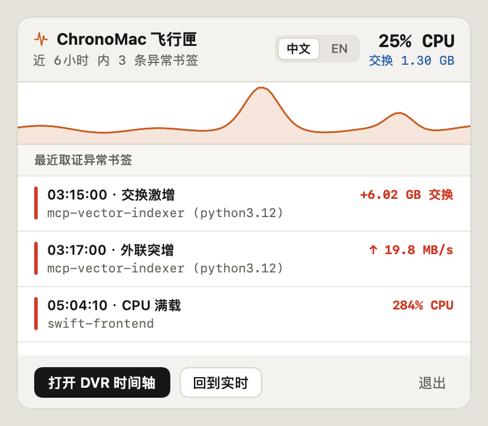

# ChronoMac

**[English](README.md)** | **简体中文**

**macOS 7 天系统飞行记录仪 · 五轨 DVR 示波时间轴与进程级外联网络账本 (`v0.2.0`)**

系统自带的「活动监视器」与 `btop` 只能看到**此时此刻**——如果凌晨 03:14 你的 MacBook 突然热压降频、虚拟内存交换区暴涨 6 GB，或在无人值守时静默上传了 400 MB 数据，而肇事子进程在五分钟后自动退出，现场证据便会彻底消失。

**ChronoMac `v0.2.0`** 在 **100% 普通用户态（免 Root、零内核扩展 `KEXT`、无需付费 `NetworkExtension` 权限）** 下持续记录主机遥测指标、Top-30 历史进程追责快照、外部 TCP/UDP 套接字流量增量，以及本地 AI 编程代理活跃窗口（`Claude Code`、`Codex CLI`、`OpenCode`），并写入严格受控的 SQLite WAL 时序飞行匣（体积上限 `<= 250 MB`）。`v0.2.0` 原生内置 **`中文 / EN` 双语实时切换**（支持 `⇧⌘L` 快捷键与中文 macOS 系统语言自动识别）。


---

## 核心特性

- **五轨同步 60fps DVR 示波时间轴 (`TimelineScrubberCanvas`)** — 在 **1小时 / 6小时 / 24小时 / 7天** 窗口内顺滑拖拽回放，同屏关联分析芯片 CPU 与温控状态、常驻内存与虚拟交换区、磁盘每秒读写吞吐、网络上下行速率与 AI 编程代理活跃时段。
- **事后历史进程追责（即使进程已退出）** — 点击任意异常事件书签即可穿越回峰值时刻，查看精确 PID、可执行文件路径、Apple / 开发者 Team ID 签名、CPU 占用、常驻内存与上行速率，并醒目标注峰值后已退出的短命进程（`峰值后已退出`）。
- **进程级外部套接字外联账本** — 解析非特权 `nettop` 字节增量并配合异步本地 PTR 反向 DNS 解析（自动剔除 `127.0.0.1` 本地回环流量），清晰呈现**哪个可执行程序**连接了**哪个远程域名/IP** 以及累计上下行流量。
- **峰值保留型三级 SQLite WAL 滚动压缩** — 近 2 小时保留 `2s` 原始采样，2–24 小时聚合为保留峰值的 `15s` 分桶，24 小时–7 天聚合为 `60s` 分桶，并通过 `PRAGMA incremental_vacuum` 严格遵守 `250 MB` 容量上限。
- **原生 `中文 / EN` 实时双语仪器界面 (`v0.2.0`)** — 首次启动自动识别简体/繁体中文 macOS 系统环境，主窗口顶栏与菜单栏弹窗均配备高对比度 `中文 | EN` 分段切换胶囊，支持 `⇧⌘L` 一键无刷新切换与 `--lang zh|en` 命令行参数覆盖。
- **菜单栏飞行匣 + 无界面 CLI + 只读 MCP 服务器** — 同时提供暖钛金属仪器风格桌面应用与标准 stdio MCP 服务（`--mcp`），让 Claude Code、Codex 或 OpenCode 直接基于历史遥测回答「15 分钟前我的 Mac 为什么突然卡顿？」。

<p align="center">
  
</p>

---

## 安装指南 (`v0.2.0`)

### Homebrew Cask（macOS 14.0+，Apple Silicon）

```bash
brew tap zxu756/tap
brew install --cask chronomac
```

### 下载发行压缩包

从 Releases 下载 `ChronoMac-v0.2.0-macos-arm64.zip`，解压并将 `ChronoMac.app` 拖入 `/Applications`，如遇首次打开提示可执行：

```bash
xattr -cr /Applications/ChronoMac.app
```

### 从源码构建

```bash
git clone https://github.com/zxu756/ChronoMac.git
cd ChronoMac
swift test --no-parallel
./Scripts/build-app.sh
open build/ChronoMac.app
```

---

## 命令行与 MCP 服务器用法

### 无界面 CLI 与语言参数

```bash
# 指定启动界面语言（zh 或 en）
/Applications/ChronoMac.app/Contents/MacOS/ChronoMac --lang zh

# 查看当前 Mach 主机实时读数与飞行匣状态
/Applications/ChronoMac.app/Contents/MacOS/ChronoMac --cli status

# 回溯 10 分钟前的历史进程追责快照
/Applications/ChronoMac.app/Contents/MacOS/ChronoMac --cli blame --at 10m

# 汇总近 6 小时内的交换激增、热压降频与外联突增异常
/Applications/ChronoMac.app/Contents/MacOS/ChronoMac --cli anomalies

# 列出近 24 小时累计外联字节最高的远程端点
/Applications/ChronoMac.app/Contents/MacOS/ChronoMac --cli egress
```

### Model Context Protocol (`--mcp`)

将 `ChronoMac` 接入 Claude Code、Codex 或 OpenCode，辅助排查编译与基准测试期间的系统瓶颈：

```json
{
  "mcpServers": {
    "chronomac": {
      "command": "/Applications/ChronoMac.app/Contents/MacOS/ChronoMac",
      "args": ["--mcp"]
    }
  }
}
```

内置只读 MCP 工具：
- `chrono_summary_window` — 汇总最近 `N` 分钟内的 CPU 峰值、交换峰值、外联峰值及异常书签。
- `chrono_inspect_timestamp` — 查询指定 Unix 时间戳或 `minutes_ago` 时刻的历史进程快照。
- `chrono_top_egress_endpoints` — 按可执行程序分组统计高流量外部套接字目标主机。

---

## 存储与隐私架构

- **数据库路径**：`~/Library/Application Support/ChronoMac/flightbox.sqlite`
- **零遥测上传**：所有 Mach 内存/CPU 计数器、`proc_pid_rusage` 指标、`nettop` 增量与本地 PTR 查询结果均严格保存在本机磁盘；AI 编程代理关联仅读取会话文件修改时间戳，绝不读取任何对话提示词内容。

## 开源许可

MIT License — 详见 [LICENSE](LICENSE)。
